# DiveDebrief

A dive log that coaches you. Upload the files from your dive computer and
DiveDebrief scores how well each dive was dived (ascent control, safety
stop, buoyancy, air use), explains every score in plain words, and gives you
one thing to work on next time. Along the way you fill a background ocean
with sea creatures you unlock by diving.

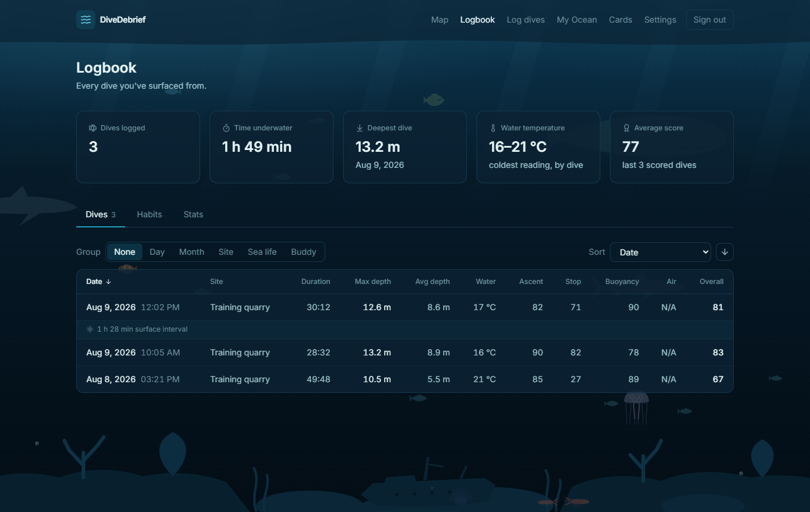

- [Features](#features)
- [Getting your dives in](#getting-your-dives-in)
- [Run it](#run-everything-with-docker)
- [Project layout](#project-layout)
- [Scoring](#scoring)

## Features

### A globe of everywhere you've dived

The home page is a globe with a pin for each dive site. Click a site to fly
in to the entry and exit points of each dive, name the site (with nearby
names suggested from OpenStreetMap), set fresh or salt water, and see that
site's average scores, sea life and landmarks.

| Every site | One site |
| --- | --- |
| 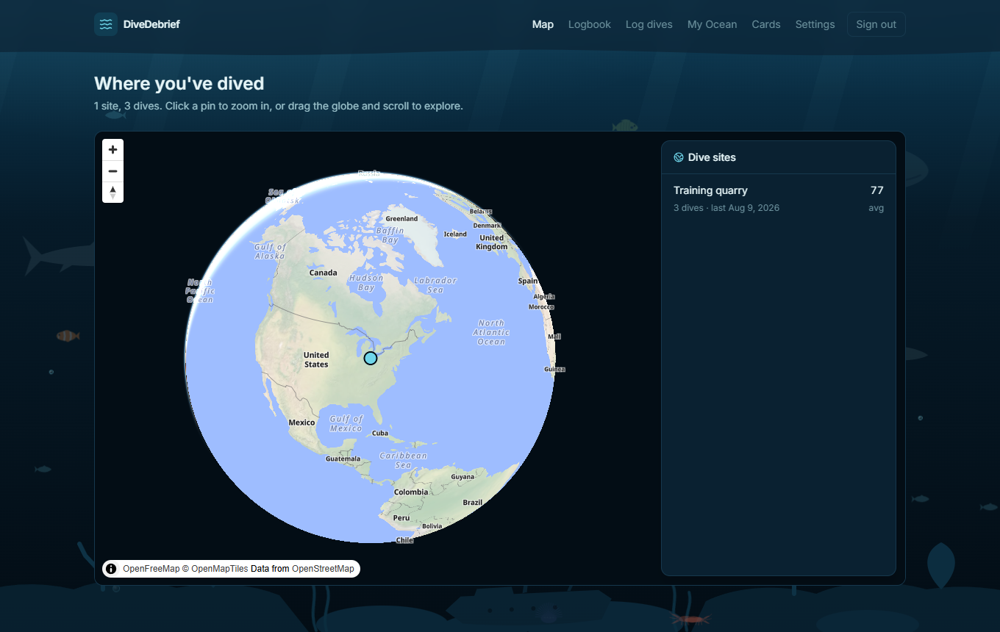 | 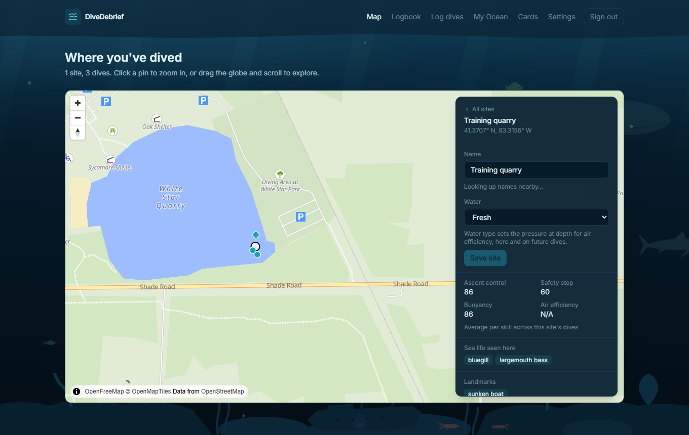 |

### A scorecard for every dive

Each dive leads with its scores and key numbers. Every skill is scored
0–100 with the reason written next to it, and links to the moment on the
profile that cost points. A skill that can't be scored shows **N/A and
says why**. It never shows a made-up number. Dives on the same day show the
surface interval between them.

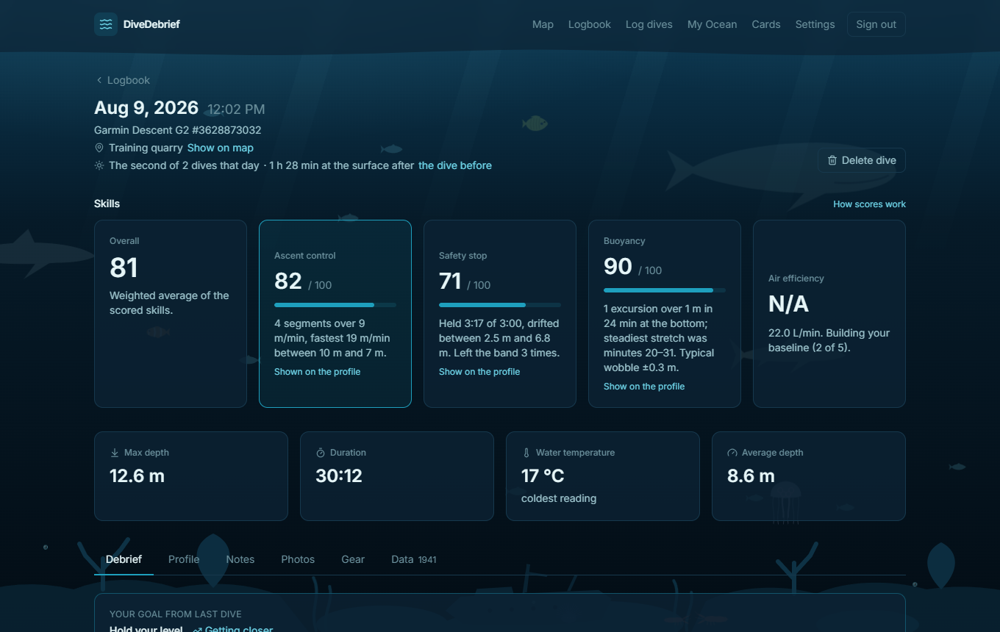

### Debrief: what to work on next

The Debrief tab turns the scores into coaching: a headline, one goal for
your next dive, what to work on and what went well, each with a link to the
exact moment on the profile. On your next dive, it checks how you did against
the goal you set. The rules live in `backend/app/debrief.py`. No AI is
involved, so the advice is predictable and testable.

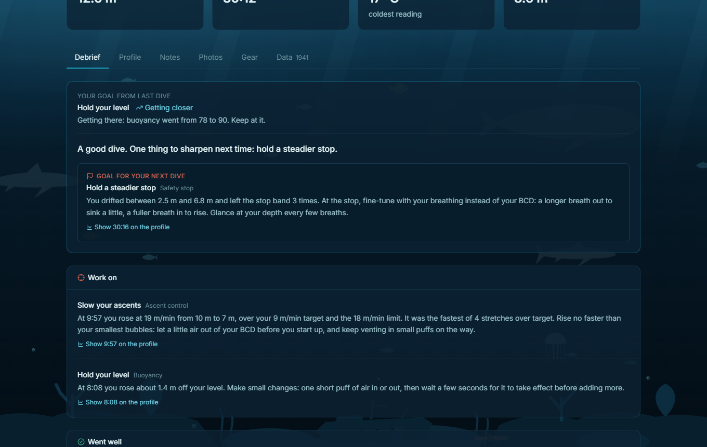

### Profile graphs

The depth profile highlights ascents over your target rate. You can add
graphs for ascent rate, temperature, heart rate, NDL, time to surface,
tissue loading, CNS, ppO₂ and gas density, either stacked or overlaid like
Subsurface.

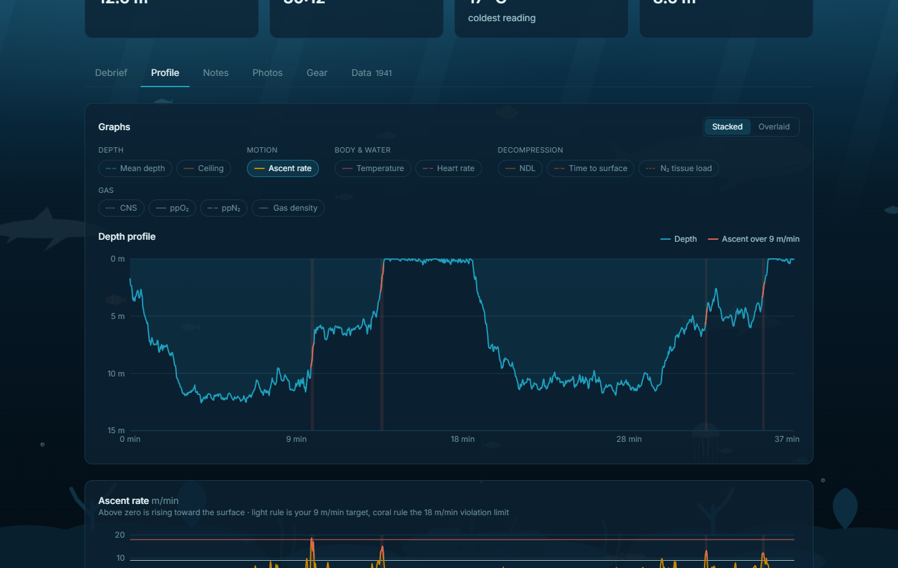

### Notes, conditions, photos and gear

- **Notes:** how the dive felt, visibility, buddy, sea life and landmarks
  as tags, and free text. The thermocline is detected from your watch's
  temperatures, so you don't need to enter it.
- **Photos:** attach photos to a dive.
- **Gear:** weights, exposure suit and tank. *Your weighting* compares your
  weight with your buoyancy score from dive to dive. Save a setup as a
  **kit** and apply it to any dive in one click.
- **Tank:** enter start and end pressure when your computer has no
  transmitter, and DiveDebrief works out your air use (SAC) for the air
  efficiency score.

| Notes | Gear |
| --- | --- |
| 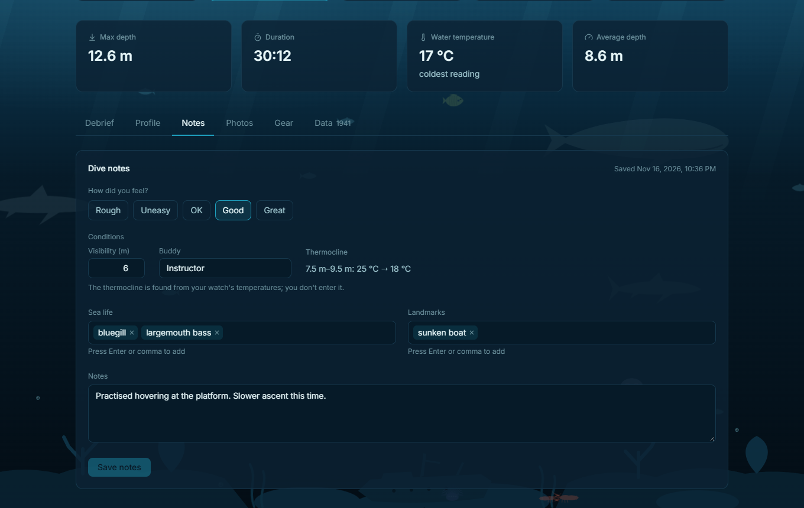 | 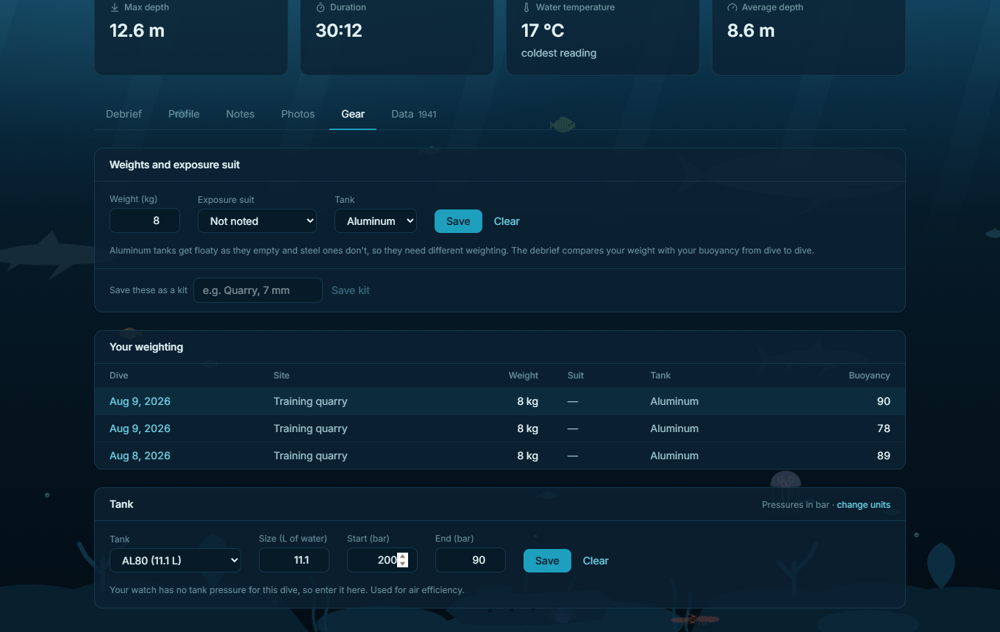 |

### The logbook

The logbook shows totals (dives, time underwater, deepest dive, water
temperature, average score) and every dive with its scores. You can group by
day, month, site, sea life or buddy, and sort by any column. The **Habits**
tab tracks your ascent habits over time, and **Stats** has the rest.

### My Ocean: achievements

57 sea creatures in five tiers, from Common to Legendary. Each one is
unlocked by an achievement, such as logging your first dive, naming a site,
holding a full safety stop, or doing two dives in one day. Unlocked creatures
swim through the background of every page. Locked creatures show as `???`
silhouettes, and the API never sends their names, so they stay a surprise.

| Your collection | A new unlock |
| --- | --- |
| 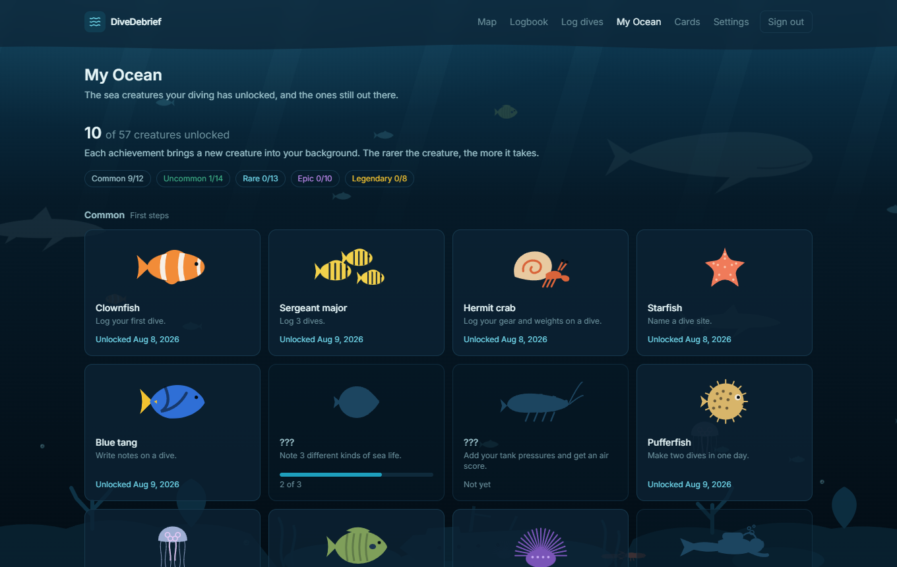 | 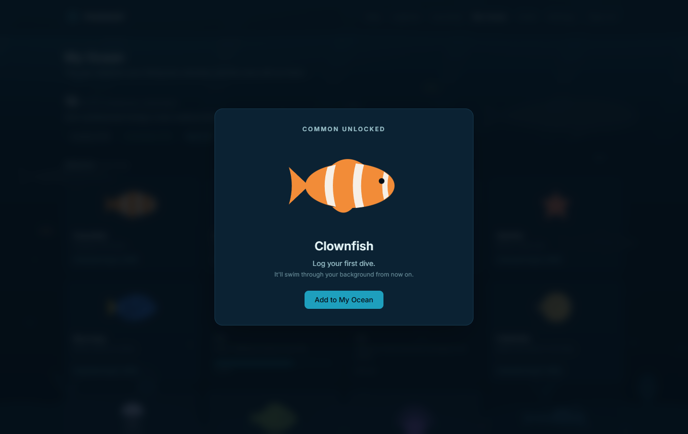 |

Every drawing is its own SVG in `frontend/src/assets/sea/` (creatures in
`creatures/`, the background in `scene/`), so you can open and edit it in any
vector editor. Colours come from the file as drawn, and the canvas can be
resized freely.

### Certification cards and settings

- **Cards:** keep photos of the front and back of your certification cards.
- **Settings:** metric or imperial units, Easy / Normal / Hard grading
  (Easy is the default, and forgiving for new divers), and the scoring
  thresholds, such as ascent target, safety stop depth and length, and the
  minimum depth for a safety stop. Changing a setting re-scores every dive.
- **How scores work** (`/scores`) explains each rule using your current
  settings.

## Getting your dives in

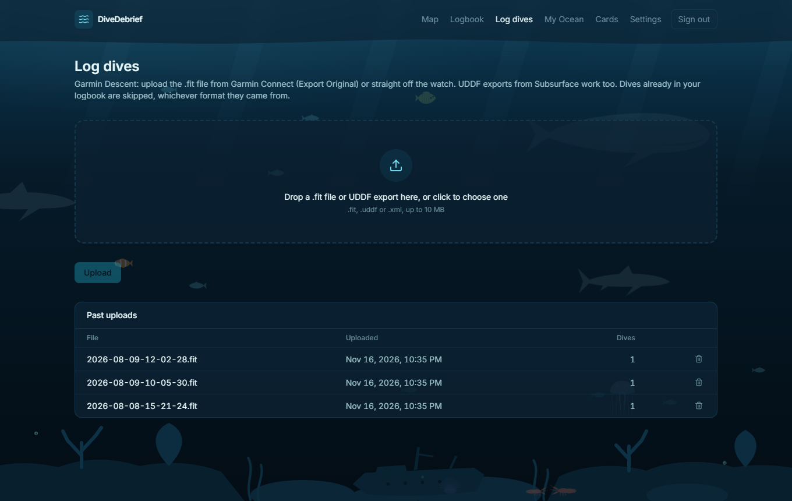

DiveDebrief accepts:

- **Garmin `.fit` files**, from Garmin Connect → *Export Original*, or
  straight off the watch over USB. FIT files also bring heart rate, NDL,
  decompression data, tank pressure on air-integrated models, water type and
  GPS position.
- **UDDF exports**, for example Subsurface → File → Export → UDDF.

A dive is identified by its start time, so the same dive uploaded as FIT and
as UDDF is stored once.

## Run everything with Docker

```sh
docker compose up --build
```

Web app at http://localhost:3000, API at http://localhost:8000. The
database runs migrations on start. Uploaded photos are stored in the
`uploads` Docker volume, and the database in `pgdata`.

> `docker-compose.yml` currently turns on `ACHIEVEMENT_TEST_MODE`, a
> temporary panel on My Ocean for previewing reveals and creatures without
> earning them. It will be removed once achievements are tuned.

## Local development

Backend:

```sh
docker compose up -d db
cd backend
python -m venv .venv && .venv/Scripts/pip install -r requirements.txt
cp .env.example .env   # then set SECRET_KEY (the command is in the file)
.venv/Scripts/alembic upgrade head
.venv/Scripts/uvicorn app.main:app --reload
```

Frontend (http://localhost:5173):

```sh
cd frontend
npm install
npm run dev
```

### Configuration

The backend reads these from the environment or `backend/.env`:

| Variable | Default | |
| --- | --- | --- |
| `SECRET_KEY` | *(required)* | At least 32 characters; signs login tokens |
| `DATABASE_URL` | local Postgres | `postgresql://` URLs are accepted too |
| `CORS_ORIGINS` | `http://localhost:5173` | Comma-separated |
| `UPLOAD_DIR` | `data/uploads` | Where card and dive photos are stored |
| `MAX_UPLOAD_BYTES` | 10 MB | Largest dive file accepted |
| `ACHIEVEMENT_TEST_MODE` | `false` | Temporary; see above |

The frontend reads `VITE_API_URL` at build time (default
`http://localhost:8000`).

## Accounts

Each diver signs up with an email and password and only sees their own
uploads and dives. The first account created also takes over any dives
uploaded before accounts existed (V1 data).

## Tests

```sh
cd backend && .venv/Scripts/python -m pytest   # API tests need the db container running
cd frontend && npm run lint && npm run build
```

CI runs the backend tests, the frontend lint and build, and both Docker
image builds on every pull request into `main`.

## Project layout

| | |
| --- | --- |
| **Backend** | Python, FastAPI, SQLAlchemy 2, Alembic, PostgreSQL 16; Garmin FIT SDK and lxml for parsing |
| **Frontend** | React 19, TypeScript, Vite, Tailwind CSS 4, Recharts, MapLibre GL with OpenFreeMap tiles |

```
backend/app/
  parsing/      FIT and UDDF parsers
  scoring/      one module per skill, plus settings and difficulty
  analysis/     profile analysis shared by scoring and the debrief
  debrief.py    rule-based coaching for the Debrief tab
  achievements.py  the 57 creatures and what unlocks each
  dive_day.py   same-day dives and surface intervals
  places.py, marine.py  site name suggestions (OpenStreetMap, Natural Earth)
  routers/      the API, one file per resource
backend/alembic/versions/  database migrations
frontend/src/
  pages/        one file per page
  components/   tabs, charts, the globe, the sea creatures
  assets/sea/   every drawing, as editable SVG
docs/V2_SCOPE.md  the V2 plan and the decisions behind it
```

## Scoring

Skill scores are computed on the backend (`backend/app/scoring/`), stored
per dive, and recomputed when a diver changes their settings or
`ALGORITHM_VERSION` is bumped. Each skill module's docstring states its
rules, and `tests/test_scoring.py` checks hand-derived scores for synthetic
profiles. `tests/test_real_scores.py` pins the scores of the three real dives.
Bump `ALGORITHM_VERSION` whenever a change could alter a score.

| Skill | What it measures |
| --- | --- |
| Ascent control | Share of ascent time at or under your target rate (9 m/min by default), with the last 6 m counting double and penalties for stretches over 18 m/min |
| Safety stop | Time held still in the 3–6 m band after the deepest point, against a 3:00 target, minus band exits and drift. Only for dives deeper than 10 m |
| Buoyancy | How steadily you hold your depth during the bottom phase, ignoring deliberate depth changes |
| Air efficiency | Your surface air consumption compared with your own baseline, once you have enough dives with tank pressures |
| Overall | Weighted average of the skills that could be scored |

### Bottom phase (buoyancy)

Buoyancy is judged only on the bottom phase, found like this:

1. The dive is split at surface intervals (0.75 m or shallower). Each stretch
   underwater of a minute or more gets its own bottom phase.
2. A plateau is 30 s or more where the depth rate, averaged over 30 s, stays
   under 3 m/min either way.
3. The descent ends at the first point within 1 m of the first plateau's depth.
4. The diver leaves for good at the last moment deeper than the safety stop
   band plus its tolerance (6.5 m by default). The final ascent starts at the
   last point within 1 m of the last plateau before that. Stretches that never
   go that deep use their last plateau. This keeps the climb to the stop and
   the stop itself out of the buoyancy score.
5. Bottom phases under a minute are dropped; under 3 minutes in total is N/A.
